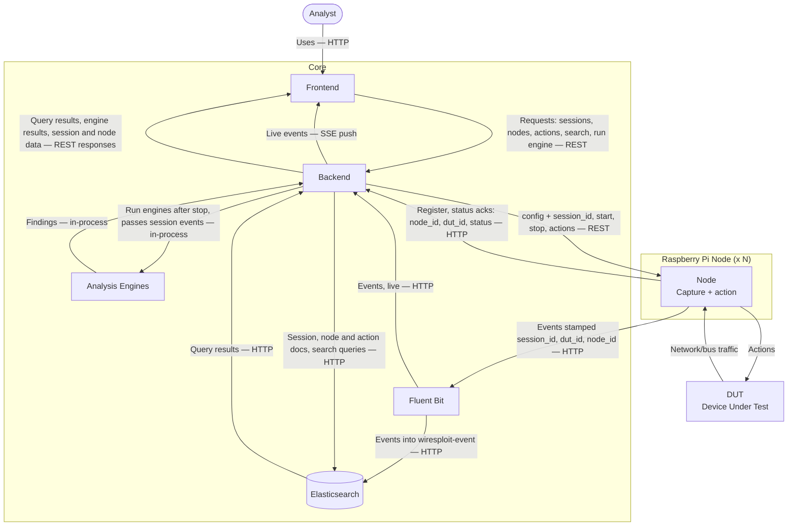
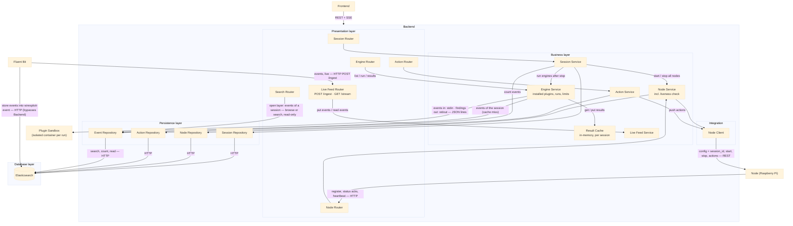
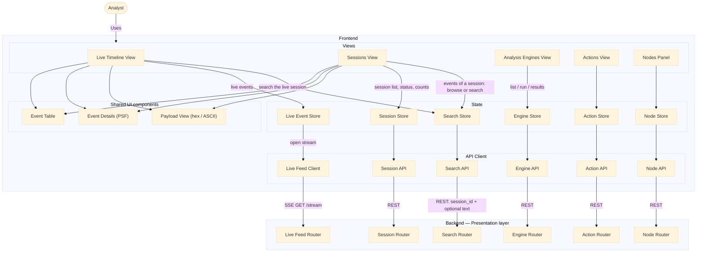
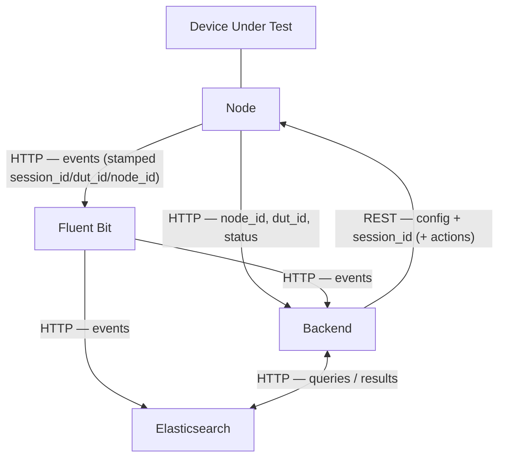
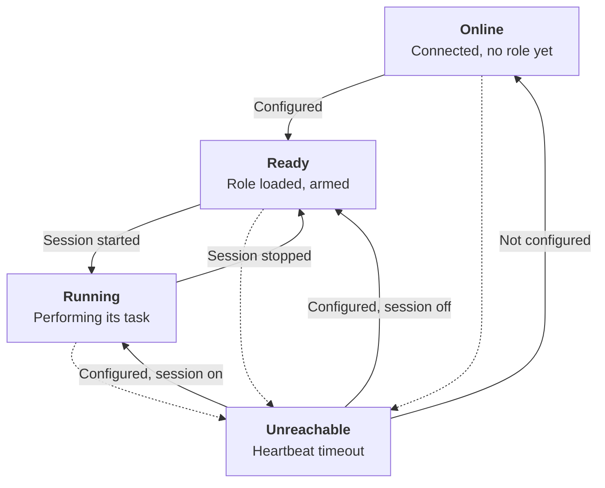
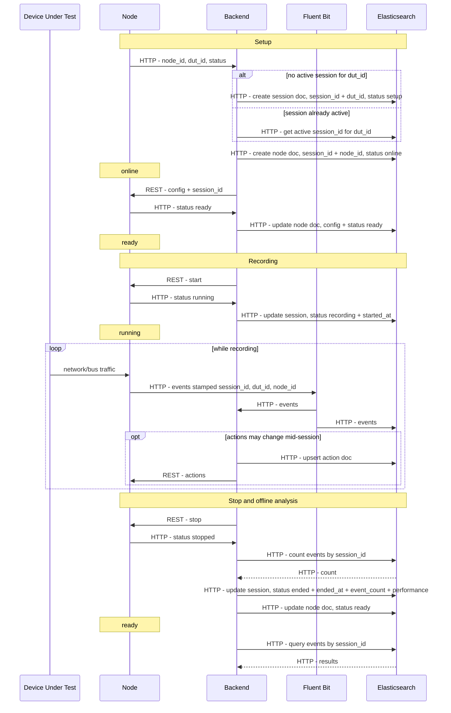

# Wiresploit — Plan

The diagrams and the database schema, with nothing else. This file is the single point of truth for both.

The diagrams are ordered from the **widest view** to the **most detailed**: each one zooms into a box of the previous one. The last section is the Elasticsearch schema.

| § | Diagram |
|---|---|
| 1 | Container — which pieces exist, and which may talk to which |
| 2 | Component — Backend |
| 3 | Component — Frontend |
| 4 | Flowchart — how a session and a node are bound together |
| 5 | State — the node |
| 6 | Sequence — everything above, in order |
| 7 | Elasticsearch schema |

The diagram source code lives in [`README.md`](README.md); it is copied here so each explanation sits next to its picture. In every component diagram an **arrow means "calls / depends on"** — results travel back along the same arrow.

---

## 1. Container Diagram

### 1.1 What a container diagram shows

A **container diagram** shows the **separately running pieces** of the system — programs, services, databases — and how they communicate: which one talks to which, using which protocol, carrying which data.

It deliberately does **not** show what is *inside* each piece. That is the job of the component diagrams that follow. Here, "container" means "a thing that runs on its own" — it is not limited to Docker containers, although on the Core most of them do run in Docker.

### 1.2 The diagram



> **Note on the analysis-engine arrows.** They are labelled *in-process*, which reflects an earlier version of the design. What is settled is that engines run **isolated, in their own container per run**; the way data is carried in and out is **not yet determined** — see §1.4.8.

### 1.3 The system in one paragraph

Nodes listen to the DUT and send every event they capture to **Fluent Bit**. Fluent Bit sends each event **two ways at once**: to **Elasticsearch**, which stores it permanently, and to the **Backend**, which pushes it live to the **Frontend** so the analyst sees it immediately. Separately, the **Backend** controls the nodes — it sends them their configuration, tells them to start and stop recording, and sends them actions. When a recording stops, the Backend hands the recorded events to the **Analysis Engines**, which return findings. The analyst does everything through the Frontend, which only ever talks to the Backend.

There are therefore **two independent paths** through the system:

| Path | Direction | What travels | Carried by |
|---|---|---|---|
| **Data path** | Node → Fluent Bit → Elasticsearch **and** Backend → Frontend | Captured events (high volume, continuous) | HTTP from the node, HTTP fan-out from Fluent Bit, SSE to the browser |
| **Control path** | Backend ↔ Node | Configuration, start, stop, actions, status, heartbeats (low volume) | REST from the Backend, HTTP from the node |

Keeping them separate is deliberate: the heavy, continuous flow of events never competes with the small, important control messages.

### 1.4 The boundaries and every element

The diagram has two boundaries — the **Raspberry Pi Node (x N)** and the **Core** — plus two things outside both: the **Analyst** and the **DUT**.

#### 1.4.1 Analyst

The person using Wiresploit. They interact with the system **only through the Frontend**, in a web browser.

- There is **one** analyst and **one** browser at a time.
- The browser runs on the Core PC itself.
- The final system is **air-gapped**: the PC and the nodes sit on an isolated local network with **no internet access**.

#### 1.4.2 DUT — Device Under Test

The device being analysed. It is outside both boundaries because Wiresploit runs **no software on it** — it only observes it and, when asked, acts on it.

- **DUT → Node, "Network/bus traffic":** the node is physically attached to the DUT and taps its communication: internal buses (**UART, SPI, I2C**) through wires on the DUT's pins, and network traffic (**Ethernet**) through a network tap. The DUT is not on Wiresploit's network.
- **Node → DUT, "Actions":** the reverse direction — the node actively sends something to the DUT, such as an injected packet. This is how Wiresploit tests how the DUT reacts to crafted or malicious input.

#### 1.4.3 Node — the Raspberry Pi (capture + action)

A Raspberry Pi running Wiresploit's **Node Agent**, a Python program (FastAPI, port `:9000`) that runs directly on Raspberry Pi OS, not in Docker. The `x N` means there can be **any number of nodes**; several nodes can watch the same DUT at once (one on its UART, one on its network, and so on).

A node has exactly **two capabilities** — there are no fixed node "roles":

1. **Capture.** It listens to the DUT, decodes the protocol (UART, SPI, I2C, network), and turns what it hears into **events**. *How* it captures is described by its **configuration** — for example, which bus to listen to and at which baud rate.
2. **Actions.** It performs things on the DUT: injection, snapshot, custom scripts, and any future kind of action. All of these are simply different **action types**.

Before sending an event, the node **stamps** it with three identifiers:
- **`session_id`** — which recording it belongs to. The node receives this from the Backend together with its configuration.
- **`dut_id`** — which device it came from. The node already knows this; it is part of how the node is set up.
- **`node_id`** — which node captured it.

Stamping happens **on the node, at the source**. This is what lets Fluent Bit store events in Elasticsearch without knowing anything about sessions — every event already carries the information that ties it to its session. As a result, **no event can ever exist without a session**.

The node also:
- **registers** with the Backend when it comes up,
- **acknowledges** every command the Backend sends (so the Backend only records a state change once the node confirms it),
- sends a regular **heartbeat**, so the Backend can tell when the node has disappeared.

**Rule:** a node's configuration is **frozen while a session is recording**. The only thing that can change on a node mid-recording is its **actions**.

#### 1.4.4 Frontend

The web application the analyst uses: **React** with TypeScript, compiled into static files and served by **nginx** on port `:5173`. nginx also forwards (proxies) the browser's API requests to the Backend, so the browser talks to a single address.

It provides the views: the **Live Timeline** (events of the session being recorded, appearing as they arrive), **Sessions** (recorded sessions, which can be opened and compared side by side), **Analysis Engines** (run engines and read their findings), **Actions** (manage each node's actions), and a **Nodes panel** (each node and its current state).

**The Frontend does no real work.** It shows information and sends requests; every rule, every database access and every message to a node happens in the Backend. It **only talks to the Backend** — never to Elasticsearch, Fluent Bit or a node directly.

#### 1.4.5 Backend

The application server: **Python, FastAPI**, on port `:8000`. There is exactly **one** backend. (The prototype had two — a main backend and a separate injection backend — but the final system merges them; actions are part of the single Backend.)

It is the system's coordinator. It:
- **manages sessions** — creates them, starts and stops them, and records when they started, when they ended and how many events they contain;
- **manages nodes** — handles their registration, sends their configuration, tracks their state, and notices when they go silent;
- **manages actions** — saves them and pushes them to the right node;
- **relays the live feed** — receives events from Fluent Bit and pushes them to the browser;
- **serves search and browsing** of recorded events;
- **runs the analysis engines** when a session ends.

It **owns** the session, node and action records in Elasticsearch. It **never writes events** — that is Fluent Bit's job. For events, the Backend only **reads, searches and counts**.

Internally the Backend follows a **layered architecture** (presentation → business → persistence → database); this is explained in the Backend component diagram.

#### 1.4.6 Fluent Bit

An off-the-shelf log and data forwarder. In Wiresploit it is the **single entry point for captured data**: every node sends its events to it (over HTTP; its input listens on port `:9880`, Fluent Bit's default — to be confirmed).

Its only job is **fan-out**: every event it receives is forwarded to **two destinations at the same time**:

1. **Elasticsearch** — "Events into wiresploit-event": the permanent copy. This is the storage path. Every event ends up here, and this copy is the one used later for searching, for opening a recorded session, and for analysis.
2. **Backend** — "Events, live": a second copy for display only. The Backend forwards it straight to the browser so the analyst sees the event within moments of it being captured. Nothing on this path is stored.

Two important properties follow from this design:

- **Fluent Bit holds no session state.** It does not know what a session is, which session is recording, or which node belongs to where. It receives an event, copies it to two places, and forgets it. It can do this because the node already stamped the event with `session_id`, `dut_id` and `node_id` — everything needed to file the event correctly is inside the event itself. Fluent Bit is therefore a **pure, static fan-out**: configured once, never reconfigured per session.
- **Storage does not depend on the Backend.** Events reach Elasticsearch even if the Backend is restarting, busy or broken. This is what makes the system's central rule — *never drop data* — achievable: the storage path is short and has nothing in it that can decide to discard an event.

This also explains why **the Backend never writes events**. If the Backend also wrote them, there would be two writers and a risk of duplicates or gaps. There is exactly one writer of events: Fluent Bit.

#### 1.4.7 Elasticsearch

The database: **Elasticsearch**, on port `:9200`, storing its data on a **Docker volume** so the data survives the container being removed or rebuilt.

Elasticsearch was chosen over a traditional relational database for one dominant reason: **search inside payloads is the project's top requirement.** The analyst must be able to type `password` and find it appearing in the middle of any captured payload, in a live session, immediately. Elasticsearch is built for exactly this kind of text and pattern search over very large amounts of data, so Wiresploit uses Elasticsearch's own search engine rather than implementing searching itself.

It holds **four indexes** (an *index* in Elasticsearch is roughly what a *table* is in a relational database):

| Index | Holds | Written by |
|---|---|---|
| **`wiresploit-event`** | Every captured event: timestamp, `session_id`, `dut_id`, `node_id`, event type, protocol, duration, length, `payload_hex`, and `psf` | **Fluent Bit only** |
| **`wiresploit-session`** | One record per recording: `session_id`, `dut_id`, name, status, start and end time, event count, performance | Backend |
| **`wiresploit-node`** | One record per node **per session**: its identity, status and the exact configuration it was given | Backend |
| **`wiresploit-action`** | Every action: which node it belongs to, its type, its trigger, whether it is enabled, and its settings | Backend |

The four are tied together by three shared fields — **`session_id`**, **`dut_id`** and **`node_id`**. Elasticsearch has no foreign keys and does not enforce these links; keeping them correct is the responsibility of the Backend (which issues the IDs) and the node (which stamps them onto events). One session has many nodes, many events and many actions; one node produces many events and runs many actions.

Storing the node's configuration **per session** matters: it means a recorded session carries the exact settings used to capture it (which bus, which baud rate, which pins). Without that, the stored bytes could not be interpreted or reproduced later.

#### 1.4.8 Analysis Engines

The automated analysis. An engine reads the events of one recorded session and produces **Findings** — statements such as *"a password was transmitted in plain text"*, each referencing the specific events that prove it.

The engines are a **black box**. Their internal design is deliberately not covered here, and **most of their boundary is not yet determined either.** What follows separates the two.

**What is settled:**

- **Isolation.** Each analysis runs in **its own container, created for that one run and destroyed afterwards**. The container has **no network access**, a **read-only filesystem**, no special operating-system privileges, and limits on CPU, memory and running time. Engines are plugins and may be untrusted or simply buggy; a faulty engine must not be able to damage the system, reach the database, or reach the nodes.
- **The engine never fetches anything.** It has no database credentials and no way to make a request — this follows from having no network. The Backend reads the session's events and **hands them to the engine**; the engine can only work with what it is given.
- **The engine answers; it never asks.** There is no path from engine code back into the Backend.
- **Analysis runs over a finished session**, not during recording. A recorded session is immutable, and live capture must never compete with analysis for resources.

**What is not yet determined:**

- **How events and findings are carried.** The diagrams show standard input and standard output, JSON one record per line. That is the current sketch, **not a decision**.
- **The shape of a Finding.** Every engine emits this and the interface renders it without knowing which engine produced it, so it is the most consequential of the open items — and none of its fields are agreed.
- **What happens to findings afterwards** — cached in memory, written to Elasticsearch, or recomputed on demand. The diagrams show an in-memory Result Cache and nothing stored; that is also provisional.
- **Who starts a run** — automatically when a session stops, or the analyst choosing an engine later. The diagrams in this document currently show **both**, which is a contradiction to resolve.
- **How the limits are enforced**, and what the system reports when an engine exceeds them, crashes, or returns something malformed.
- **Which engines exist at all**, and what question each one answers.

#### 1.4.9 Why the engines are shown inside the Core

They run on the PC, like everything else inside the Core boundary. "Core" means the PC and everything on it, so the engines belong there even though each run is a separate short-lived container.

### 1.5 Every connection, one by one

This is the complete list of arrows in the container diagram: who starts the conversation, over which protocol, carrying what, and why.

| # | From → To | Protocol | What travels | Who starts it |
|---|---|---|---|---|
| 1 | DUT → Node | UART / SPI / I2C / Ethernet tap | The DUT's raw traffic | The DUT (it simply emits; the node listens) |
| 2 | Node → DUT | Same wires | Actions — injected data, probes | The node, when told to by the Backend |
| 3 | Analyst → Frontend | HTTP | Clicks and typing in the browser | The analyst |
| 4 | Frontend → Backend | REST | Requests: create/start/stop a session, configure a node, create/fire an action, search, run an engine | The Frontend |
| 5 | Backend → Frontend | REST responses | Query results, engine findings, session and node data | Answer to #4 |
| 6 | Backend → Frontend | **SSE** | Live events, pushed as they arrive | The Backend pushes; the Frontend opened the channel once |
| 7 | Node → Backend | HTTP | Registration (`node_id`, `dut_id`, `status`), acknowledgements, heartbeats | The node |
| 8 | Backend → Node | REST | Configuration + `session_id`, start, stop, actions | The Backend |
| 9 | Node → Fluent Bit | HTTP | Captured events, stamped with `session_id`, `dut_id`, `node_id` | The node |
| 10 | Fluent Bit → Backend | HTTP | The live copy of each event | Fluent Bit |
| 11 | Fluent Bit → Elasticsearch | HTTP | The stored copy of each event | Fluent Bit |
| 12 | Backend → Elasticsearch | HTTP | Session, node and action records; search and count queries | The Backend |
| 13 | Elasticsearch → Backend | HTTP responses | Query results | Answer to #12 |
| 14 | Backend → Analysis Engine | stdin, JSON lines | The events of one session | The Backend |
| 15 | Analysis Engine → Backend | stdout, JSON lines | Findings | Answer to #14 |

#### Notes on the connections that are easy to misread

**#4, #5 and #6 — three arrows between Frontend and Backend, not one.** Most web traffic is *request and response*: the browser asks a question (#4) and gets one answer (#5). The live feed is different. The browser opens **one long-lived connection** and then simply waits; whenever a new event arrives, the Backend writes it into that open connection (#6). The browser never has to ask again. This is **Server-Sent Events (SSE)**, and it is used for exactly one thing: the live timeline. Everything else is ordinary REST.

**#7 and #8 — the two directions are separate conversations.** The node sends things *to* the Backend (#7: "I exist", "I am ready", "I am still alive"). The Backend sends things *to* the node (#8: configuration, start, stop, actions). They travel over different connections in different directions. All four kinds of command — config, start, stop, actions — go over the **same single control path** (#8), which is why there is only one arrow for them.

**#9, #10, #11 — one event, copied twice, never travelling twice over the same path.** The node sends each event **once**, to Fluent Bit. Fluent Bit then makes two copies and sends them to two different places. The node does not send to Elasticsearch, and it does not send to the Backend.

**#14 and #15 — not network traffic.** The engine has no network at all, which is why there is no port and no URL on these arrows. The *mechanism* shown — the Backend writing events into the engine process's input and reading findings from its output, the way one program pipes data into another — is a sketch, **not yet determined** (§1.4.8). What is settled is only that the engine is handed its data and cannot fetch anything.

### 1.6 What each container listens on, and what it is waiting for

Every box in the diagram is either **waiting to be contacted** (it listens on a port) or **not reachable at all**. This table says exactly what each one waits for.

| Container | Listens on | Waits for | Accepts connections from |
|---|---|---|---|
| **Frontend (nginx)** | `:5173` | The browser asking for the page, and for API calls to forward to the Backend | The browser on the PC |
| **Backend** | `:8000` | Three different callers: the Frontend's REST requests; the node's registration, acknowledgements and heartbeats; and Fluent Bit delivering live events | Frontend, nodes, Fluent Bit |
| **Fluent Bit** | `:9880` (default — to confirm) | Nodes delivering captured events | Nodes |
| **Elasticsearch** | `:9200` | Queries and writes | Backend, Fluent Bit |
| **Node Agent** | `:9000` | Commands from the Backend: configuration, start, stop, actions | The Backend only |
| **Analysis Engine** | *nothing* | It does not listen. It is started by the Backend, reads its input until it ends, writes its findings, and exits | Nobody — it cannot be contacted |
| **DUT** | *nothing (for Wiresploit)* | It is not part of Wiresploit's network. The node taps its wires | — |

Two consequences worth stating plainly:

- **The node is both a client and a server.** It *listens* on `:9000` for commands from the Backend, and it *calls out* to the Backend (status) and to Fluent Bit (events). Many people assume a node only sends; it also has to be reachable, otherwise the Backend could never configure or start it.
- **The analysis engine is the only element that is unreachable by design.** It has no port and no network. This is its security boundary.

### 1.7 How it all works together — the complete flows

These eight walkthroughs cover everything the system does. Together they explain every arrow in the diagram.

#### A. A node comes online

1. A Raspberry Pi is wired to the DUT and powered on. Its Node Agent starts.
2. The node **calls the Backend** (#7) and reports: `node_id`, `dut_id`, status.
3. The Backend checks whether a session is already open for that `dut_id`:
   - **No session yet** → it creates one in Elasticsearch (#12), in status `setup`, and generates a new `session_id`.
   - **A session is already open** → the node **joins** it. This is how several nodes end up in one session rather than each creating its own.
4. The Backend writes a **node record** (#12) for this node in this session, with status `online`.
5. The node now appears in the Frontend's Nodes panel as **Online** — connected, but not yet told what to do.

#### B. Configuring and starting a session

6. The analyst configures the node in the Frontend and the request reaches the Backend (#4).
7. The Backend sends the node its **configuration together with the `session_id`** (#8). This is the moment the node learns which session it belongs to.
8. The node applies the configuration and **acknowledges** (#7).
9. **Only after that acknowledgement** does the Backend update the node record to `ready` (#12), storing the exact configuration used.
10. The analyst presses **Start**. The Backend sends `start` to every node of the session (#8).
11. Each node acknowledges that it is now `running` (#7).
12. The Backend updates the session to `recording` and records the start time (#12).

The order in steps 8–9 is a deliberate rule: **the Backend never records a state it has not been told is true.** The node is the authority on its own state.

#### C. Capture — the steady state

13. The DUT communicates; the node's tap sees it (#1).
14. The node decodes it into **events** and stamps each with `session_id`, `dut_id`, `node_id`.
15. The node sends each event to **Fluent Bit** (#9).
16. Fluent Bit copies it to **Elasticsearch** (#11) — the permanent record — and to the **Backend** (#10) — the live copy.
17. The Backend pushes the live copy down the open SSE connection to the Frontend (#6).
18. The event appears in the Live Timeline, a moment after it happened on the wire.

If the browser is slow or closed, only the **live copies** are affected; the stored copy has already reached Elasticsearch by a path that does not involve the browser or the Backend's display logic.

#### D. Changing an action while recording

19. Mid-session, the analyst edits an action in the Frontend (#4).
20. The Backend saves it to Elasticsearch **and** pushes it to the node (#8) — always both, so the stored record and the node agree.
21. When the action fires, the node acts on the DUT (#2). The result is itself captured and travels as a normal event (#9 → #10/#11).

**Actions are the only thing that may change during a recording.** A node's capture configuration is frozen from Start until Stop, so that every event in a session was captured under the same settings.

#### E. A node goes silent

22. The node stops sending heartbeats (#7) — unplugged, crashed, or the network dropped.
23. The Backend notices the silence (nothing arrives within the expected time) and marks the node **Unreachable** (#12).
24. This state is **inferred by the Backend**, not reported by the node — a node that has failed obviously cannot report its own failure.
25. If the node comes back, it returns to the state that matches reality: `online` if it lost its configuration, `ready` if it still has it, or `running` if the session is still recording.

#### F. Stopping a session

26. The analyst presses **Stop**. The Backend sends `stop` to every node (#8); each acknowledges (#7).
27. The Backend asks Elasticsearch **how many events** carry this `session_id` (#12 → #13).
28. The Backend writes the session as `ended`, with its end time, its event count and its performance figures (#12).
29. Each node's record returns to `ready`.
30. A finished session is **immutable** — it is never added to or modified again.

#### G. Running an analysis

> ⚠️ **This flow is provisional.** Only the isolation and the hand-over of data are settled; the caching, the transport and who triggers the run are **not yet determined** (§1.4.8).

31. The analyst chooses an engine for a recorded session (#4).
32. The Backend checks whether it already has those findings in memory. If yes, it returns them immediately.
33. If not, it reads that session's events from Elasticsearch (#12 → #13), starts the engine in a fresh isolated container, and feeds the events in (#14).
34. The engine returns findings (#15). The Backend keeps them in memory and sends them to the Frontend (#5).
35. Findings are never stored in the database; if they are needed again later and are no longer in memory, the engine is simply run again.

#### H. Opening or searching a recorded session

36. The analyst opens a session from the Sessions view (#4).
37. The Backend asks Elasticsearch for the events carrying that `session_id`, ordered by time (#12 → #13), and returns them **a page at a time** as the analyst scrolls (#5).
38. Searching is the same request with a text filter added; Elasticsearch finds the text inside the payloads.
39. Nothing is ever summarised or sampled: the analyst always sees the complete event-by-event record.

### 1.8 Why the architecture has this shape

Each of these choices answers a specific requirement.

**Why a separate Fluent Bit instead of nodes sending straight to the Backend or the database.**
It gives one entry point for any number of nodes, and it splits storage from display. Storage no longer depends on the Backend being healthy, and the Backend is no longer the single point through which all captured data must pass. Adding a tenth node changes nothing in the Backend.

**Why the node stamps the IDs instead of the Backend or Fluent Bit.**
Fluent Bit is a static forwarder with no idea what a session is, and the Backend is not on the storage path. The node is the only place that both knows the session (it was given the `session_id` with its configuration) and touches every event. Stamping there means the event is self-describing from the instant it is created, and no event can exist without a session.

**Why the Backend never writes events.**
One writer means no duplicates, no gaps and no ambiguity about which copy is authoritative.

**Why SSE for live events and REST for everything else.**
Everything the analyst *asks for* is a question with an answer — REST fits exactly. Live events are not asked for; they happen. Having the browser repeatedly ask "anything new?" would be wasteful and always slightly late. With SSE the browser asks once and the Backend sends events the moment they arrive.

**Why actions and capture configuration are treated differently.**
A session is evidence. If the capture settings could change halfway through, the events before and after would not be comparable and the recording could not be reproduced. Actions are different: they are the analyst actively probing the device, which is precisely the thing that must stay possible during a live session.

**Why analysis only runs after Stop, in isolation.**
Analysis is heavy and must never slow down or endanger capture. Isolation exists because engines are plugins that may be untrusted; the sandbox guarantees that a bad engine can affect nothing but its own short-lived container.

**Why findings might be recomputed rather than stored.** ⚠️ **Not yet determined** (§1.4.8).
The argument for recomputing: a finished session never changes, so the same engine over the same events always gives the same findings, and a stored copy could fall out of date with the engine itself — for example after the engine is improved. The argument against it is cost. Undecided.

### 1.9 What this diagram deliberately leaves out

- **The inside of each container.** That is covered by the component diagrams — Backend, Frontend, Node, and the plugin boundary.
- **Timing and order.** The container diagram shows *who can talk to whom*, not *what happens first*. That is the sequence diagram.
- **The states a node moves through.** That is the state diagram.
- **The exact fields stored.** That is the data model (ER) diagram.
- **Physical machines, operating systems and ports.** That is the deployment diagram; the ports are listed in §1.6 for convenience.

---

## 2. Component Diagram — Backend

### 2.1 What a component diagram shows

A **component diagram** opens up one box of the container diagram and shows the parts inside it. The container diagram said *the Backend talks to the Frontend, the nodes, Fluent Bit, Elasticsearch and the analysis engines*. This diagram answers the next question: **inside the Backend, which part does what, and which part calls which?**

Everything outside the Backend box here — Frontend, Node, Fluent Bit, Plugin Sandbox, Elasticsearch — is already familiar from §1. They appear only so you can see where the Backend's internal parts connect to the outside world.

### 2.2 The diagram



### 2.3 How to read this diagram

**An arrow means "calls" or "depends on" — not "data flows this way."**

This is the single most important thing to understand here, and it is different from the container diagram. In the container diagram the arrows showed data moving. Here, an arrow from A to B means *A calls B*. The answer travels **back along the same arrow** and is not drawn.

So `Session Repository → Elasticsearch` means the repository sends a query to Elasticsearch; the results come back, but there is no second arrow for them. That is why you will not find a return arrow anywhere inside the Backend.

### 2.4 The layered architecture

The Backend is organised into **four layers**, which is the structure the project chose deliberately:

| Layer | What lives here | Its one job |
|---|---|---|
| **Presentation** | Routers | Receive requests from outside, hand the work to the business layer, return the answer. **No decisions, no rules.** |
| **Business** | Services | All the rules of the system. This is where the system actually *thinks*. |
| **Persistence** | Repositories | All database access. The only code that knows Elasticsearch exists. |
| **Database** | Elasticsearch | Stores the data. Outside the Backend. |

Plus one group beside persistence:

| **Integration** | Node Client | Talks to things outside the system that are **not** the database — here, the nodes. |

#### The rule that holds it together

**Calls only ever go downward.** Presentation calls business; business calls persistence and integration; persistence calls the database. A layer never calls a layer above it, and layers are not skipped.

Look at the diagram and you will see every arrow inside the Backend pointing down or sideways — never up. That is not a drawing convention; it is the rule being obeyed.

#### Why organise it this way

Each kind of change then has exactly **one place** it can happen:

- Change how a session starts → **Session Service** only. No router, no repository, no database query changes.
- Replace Elasticsearch with something else → **the repositories** only. No service and no router would notice, because they never knew what the database was.
- Change the node's protocol → **Node Client** only.
- Change a URL or a response format → **the routers** only.

It also makes the system testable: because the Session Service only knows "a repository I can call," you can hand it a fake repository and test all the session rules without running Elasticsearch at all.

### 2.5 Presentation layer — the routers

The routers are the Backend's **doors**. Each one waits for requests, checks that the incoming data has the right shape, calls the service that does the real work, and sends the answer back. If you find a rule or a decision written in a router, it is in the wrong place.

There are six, and between them they serve **three different callers**: the Frontend, the nodes, and Fluent Bit.

#### Session Router
*Called by: the Frontend.*
Handles everything about sessions: create a session, start it, stop it, list the recorded ones, open one. It passes all of it to the Session Service.

#### Node Router
*Called by: the Frontend **and** the nodes.*

This is the only router with two different kinds of caller, which is worth understanding:
- **From the Frontend:** show me the nodes and their states; here is a configuration for this node.
- **From a node:** *registration* — "I exist, here is my `node_id`, `dut_id` and status"; *acknowledgements* — "I am now ready / running / stopped"; *heartbeats* — "I am still alive."

Both go to the **Node Service**. The node calls this router; the Backend does **not** reply to a node through it — when the Backend needs to tell a node something, it uses the Node Client in the integration layer, which is a separate outbound path.

#### Action Router
*Called by: the Frontend.*
Create, edit, enable or disable, and fire actions. Passes to the Action Service.

#### Search Router
*Called by: the Frontend.*
Serves **all reading of events**: browsing a recorded session (give me this session's events, in time order) and searching inside payloads (same request, plus a text to look for). Both are the same query with and without a filter.

This router is special — see §2.9.

#### Engine Router
*Called by: the Frontend.*
Lists the available analysis engines, runs one on a session, and returns its findings. Passes to the Engine Service.

#### Live Feed Router
*Called by: Fluent Bit **and** the Frontend — on two different endpoints.*

| Endpoint | Caller | Direction | What happens |
|---|---|---|---|
| `POST /ingest` | **Fluent Bit** | Inbound | A batch of live events arrives. The router hands them to the Live Feed Service and immediately replies "received." |
| `GET /stream` | **The Frontend** | Outbound, long-lived | The browser opens this once and keeps it open. The router takes events from the Live Feed Service and writes them into that open connection as they appear. |

Two endpoints are needed because these are **two separate connections that exist at different moments**. Fluent Bit's `POST` arrives, delivers its events and closes. The browser's `GET /stream` was opened earlier and stays open for as long as the analyst is watching. Code handling one HTTP request cannot write into a different, already-open connection — so the events have to be **handed over** between them. That hand-over is the Live Feed Service.

### 2.6 Business layer — the services

This is where the system **thinks**. Every rule described in §1.7 lives in one of these five services. Each owns one subject, and nothing else is allowed to make decisions about that subject.

#### Session Service

Owns the **session lifecycle**: create or join, start, stop.

What it does:
- **Create or join.** When a node registers, this service decides whether a new session is needed for that `dut_id` or whether one is already open and the node should join it. This is the rule that keeps many nodes inside **one** session rather than creating one session each.
- **Start.** Tells the **Node Service** to start all of this session's nodes, then records the session as `recording` with its start time.
- **Stop.** Tells the Node Service to stop all nodes, asks the **Event Repository** how many events carry this `session_id`, and writes the session as `ended` with its end time, event count and performance figures.
- **Trigger analysis.** After a stop, it asks the **Engine Service** to run the engines for that session.

What it calls: Node Service (start/stop all nodes), Engine Service (run after stop), Session Repository (save the session), Event Repository (count events).

Note what it does **not** do: it never talks to a node itself, and it never reads a session's events. It only needs one number from them — the count.

#### Node Service

Owns **everything about nodes**, including their state machine.

What it does:
- **Registration.** Receives a node's first contact and creates its record for the current session.
- **Configuration.** Sends the node its configuration together with the `session_id` — through the Node Client — and records it once the node confirms.
- **Acknowledgements.** Receives "I am ready / running / stopped" and updates the node's state accordingly.
- **Start and stop.** On the Session Service's instruction, sends `start` or `stop` to every node of the session.
- **Liveness check.** A background timer that watches heartbeats. When a node has been silent too long, it marks it **Unreachable**. This is the one state change that is **inferred by the Backend rather than reported by the node** — a node that has failed cannot announce its own failure.

The rules it enforces:
- **A node's state is only written after the node confirms it.** The Backend never records a state it has merely requested.
- **Capture configuration is frozen while the session is recording.** A configuration change arriving mid-recording is refused here.

What it calls: Node Repository (save node records), Node Client (send to the node).

**Why the liveness check lives inside Node Service rather than as its own component:** it is simply one more transition in the node state machine, and that machine already belongs to this service. Splitting it out would mean two components changing node state, which is exactly what layered design tries to avoid. The only thing unusual about it is that it is triggered by a timer instead of a request.

#### Action Service

Owns **actions** — the things a node does to the DUT.

What it does: creates, edits, enables, disables and fires actions. On every change it does **two things together**: saves the action to the database **and** pushes it to the node. If only one happened, the stored record and the node would disagree.

The rule it enforces: **actions may change at any time, including while recording.** They are the one exception to the "nothing changes mid-session" principle — because actively probing the device during a live session is the whole point of having actions.

What it calls: Action Repository (save), Node Client (push to the node).

#### Engine Service, and the Result Cache

Owns **analysis runs**.

> ⚠️ Everything in this entry except the isolation is **not yet determined** (§1.4.8). The Result Cache, the standard-input/standard-output transport and the "never written to Elasticsearch" rule are all what the diagram currently sketches, not decisions.

What it does:
- Knows which engines are installed and can list them.
- When asked for a session's findings, it first checks the **Result Cache**.
- On a **cache hit**, it returns the findings immediately — no engine is run.
- On a **cache miss**, it reads that session's events from the **Event Repository**, starts the engine in an isolated container, feeds the events in on standard input, and reads the findings from standard output.
- Enforces the limits: how long an engine may run, how much memory and CPU it may use. If an engine exceeds them, it is stopped.
- Stores the findings in the Result Cache and returns them.

**The Result Cache** is plain in-memory storage, keyed by session and engine. Findings are **never written to Elasticsearch**. If the cache is lost — a restart, for example — the engine is simply run again. This is safe because a finished session never changes, so the same engine over the same events always produces the same findings.

What it calls: Result Cache, Event Repository (on a cache miss), Plugin Sandbox.

Note the direction of the sandbox arrow: the **Engine Service starts the engine and feeds it**. The engine has no way to call back into the Backend — it only answers.

#### Live Feed Service

Owns the **live display path**.

It is a small queue sitting between two routers. `POST /ingest` puts events in; `GET /stream` takes them out. That is all it does — and it never touches the database, because Fluent Bit has already stored every one of these events.

Why a queue is needed at all:
- **It lets ingest finish immediately.** Fluent Bit's `POST` returns as soon as the events are in the queue. Fluent Bit never has to wait for the browser, so the ingestion path can never be slowed down by a slow display.
- **It absorbs differences in speed.** Events may arrive in bursts while the browser consumes them steadily.
- **It is bounded.** If the browser is slow or closed and the queue fills up, the **oldest live copies are dropped**. This is permitted — and only permitted — because those are *display copies*. The permanent copy is already in Elasticsearch, placed there by Fluent Bit on a completely separate path. The project rule is precise about this: slowness may affect **delivery to the screen**, never capture or storage.

With a single browser there is no broadcasting to many viewers; the queue is purely a hand-over point and a shock absorber.

### 2.7 Persistence layer — the repositories

The repositories are **the only code in the whole Backend that knows Elasticsearch exists**. There is one per index, and each is responsible for that index alone.

A service never writes a database query. It says *"save this session"* or *"count the events of this session"*; the repository turns that into an Elasticsearch request. This is what makes the database replaceable: swap Elasticsearch for something else and only these four classes change.

| Repository | Index | What it does |
|---|---|---|
| **Session Repository** | `wiresploit-session` | Create a session, update its status and times, read one, list them |
| **Node Repository** | `wiresploit-node` | Create a node record for a session, update its status and stored configuration, list the nodes of a session |
| **Action Repository** | `wiresploit-action` | Create and update actions, list a session's or a node's actions |
| **Event Repository** | `wiresploit-event` | **Read-only.** Count a session's events, read them in time order, search inside payloads |

#### Why the Event Repository is read-only

Because **the Backend never writes events** — Fluent Bit does, on a path that does not pass through the Backend at all. There is exactly one writer of events, so there is never a question of which copy is authoritative or whether an event was written twice.

Everything the Backend does with events is reading:
- **count** — the Session Service, once, at stop;
- **read in order, a page at a time** — browsing a recorded session, and feeding the engines;
- **search** — finding text inside payloads.

#### Searching is Elasticsearch's job, not ours

The project does not implement a search engine. In-payload search is the system's top requirement, and it is the reason Elasticsearch was chosen in the first place. The Event Repository only translates a request — *"events of this session containing this text"* — into an Elasticsearch query and lets the database do the searching.

### 2.8 Integration — the Node Client

The **Node Client** is the only code in the Backend that calls a node. It sits beside the persistence layer because it plays the same role: it is the Backend's connection to something outside itself. Persistence talks to the database; integration talks to the nodes.

It sends exactly four things, all over REST to the node's own address:

| What | Sent when | Sent by |
|---|---|---|
| **Configuration + `session_id`** | When the analyst configures the node | Node Service |
| **start** | When the session starts | Node Service |
| **stop** | When the session stops | Node Service |
| **actions** | Whenever an action is created or changed — including mid-session | Action Service |

**Why one component for all four:** it is the system's **single control path to the nodes**. Everything the Backend tells a node leaves through here. If the node's protocol or address format changes, only this component changes — no service is affected.

#### Where a node's configuration actually goes

This is worth following carefully, because the configuration takes **two separate journeys**:

1. **To the node**, so it can capture: Node Service → **Node Client** → the node (`config` + `session_id`). The node applies it and starts decoding the DUT's traffic accordingly.
2. **To the database**, so the session is reproducible: Node Service → **Node Repository** → the `wiresploit-node` index — but only **after the node has confirmed** it applied the configuration.

The second journey is why the node record is written **per session** rather than once per node. Each recorded session keeps its own copy of the exact settings used for it. Without that, the stored events could not be interpreted later: the same bytes mean different things at a different baud rate, on a different bus, from a different pin. The configuration is part of the evidence, not just a setting.

### 2.9 The two places the layering is deliberately broken

Every architecture has exceptions. This one has two, and both are intentional and documented rather than accidental.

#### 1. Fluent Bit writes straight to Elasticsearch

In the diagram: `fb → es`, labelled *bypasses Backend*. Events are stored without passing through any Backend layer.

This is allowed because **ingestion is a separate pipeline, not a user request**. Keeping the storage path short and independent is what makes "never drop data" achievable — there is no business layer on that path that could fail, be slow, or decide to discard an event. The cost is that Elasticsearch receives writes from two sources; this is acceptable because they write **different things**: Fluent Bit writes only events, the Backend writes only sessions, nodes and actions. They never touch the same index.

#### 2. The Search Router calls the Event Repository directly

In the diagram: `rSearch → repoEvent`, labelled *open layer*. The presentation layer reaches the persistence layer, skipping the business layer.

This is allowed because **there is no business logic to apply**. The request is "give me this session's events, optionally containing this text"; the answer comes from Elasticsearch unchanged. A service in the middle would do nothing but pass the request along.

A pass-through service like that has a name in layered architecture — the *sinkhole* — and it is considered a flaw, not good practice: it adds a layer of code that must be written, tested and maintained while contributing no decision. The layered pattern explicitly allows an **open layer** for cases like this.

The condition that keeps it honest: **this path is read-only and rule-free.** If searching ever needed a rule — permissions, filtering by who may see what, enriching results — a Search Service would have to be introduced and the shortcut removed.

### 2.10 Following requests through the layers

The same flows from §1.7, now traced through the Backend's internals. Read each line as *calls*.

**A node registers**
`Node → Node Router → Node Service → Session Service` (create or join a session) `→ Session Repository → Elasticsearch`, then `Node Service → Node Repository → Elasticsearch` (the node record, status `online`).

**The analyst configures a node**
`Frontend → Node Router → Node Service → Node Client → Node`.
The node applies it and acknowledges: `Node → Node Router → Node Service → Node Repository → Elasticsearch` (status `ready`, configuration stored).
Note the two halves: the configuration **goes out** through Integration, and is **recorded** through Persistence — and only after the acknowledgement.

**The analyst starts the session**
`Frontend → Session Router → Session Service → Node Service → Node Client → every node`.
Each node acknowledges through the Node Router. Then `Session Service → Session Repository → Elasticsearch` (status `recording`, start time).

**A live event arrives**
`Fluent Bit → Live Feed Router (POST /ingest) → Live Feed Service` (into the queue).
Separately and continuously: `Live Feed Router (GET /stream) → Live Feed Service` (out of the queue) → written into the browser's open connection.
Nothing in this path touches a repository — the stored copy went directly from Fluent Bit to Elasticsearch.

**The analyst changes an action mid-session**
`Frontend → Action Router → Action Service`, which then does both: `→ Action Repository → Elasticsearch` and `→ Node Client → Node`.

**A node goes silent**
No request at all. The **Node Service's liveness check** fires on its timer, notices the heartbeat is overdue, and calls `Node Repository → Elasticsearch` to mark the node `unreachable`.

**The analyst stops the session**
`Frontend → Session Router → Session Service`, which:
1. `→ Node Service → Node Client → every node` (stop), each acknowledging back;
2. `→ Event Repository → Elasticsearch` (count the session's events);
3. `→ Session Repository → Elasticsearch` (status `ended`, end time, event count, performance);
4. `→ Engine Service` (run the analysis).

**The analyst runs an engine**
`Frontend → Engine Router → Engine Service → Result Cache`.
On a hit, the findings return immediately. On a miss: `Engine Service → Event Repository → Elasticsearch` (the session's events), then `Engine Service → Plugin Sandbox` (events in on stdin, findings out on stdout), then back into the Result Cache and out to the Frontend.

**The analyst opens or searches a recorded session**
`Frontend → Search Router → Event Repository → Elasticsearch`, a page at a time.
This is the open-layer path from §2.9 — no service, because there is no rule to apply.

### 2.11 Where each rule lives

One of the goals of this structure is that every rule has exactly one home. This table is the proof.

| Rule | Lives in |
|---|---|
| Many nodes join one session rather than creating several | Session Service |
| A state is recorded only after the node confirms it | Node Service |
| Capture configuration is frozen while recording | Node Service |
| Unreachable is inferred from a missed heartbeat | Node Service (liveness check) |
| Actions may change mid-session | Action Service |
| An action is saved **and** pushed, always together | Action Service |
| Analysis runs over a finished session, never during recording | Session Service, Engine Service |
| Each run is isolated in its own container | Engine Service |
| ⚠️ Findings cached in memory, never stored — *not yet determined* | Engine Service + Result Cache |
| ⚠️ Limits on time, memory and CPU — enforcement *not yet determined* | Engine Service |
| Only live display copies may be dropped under pressure | Live Feed Service |
| The Backend never writes events | Event Repository (read-only by design) |
| Searching is done by Elasticsearch, not by us | Event Repository |
| Everything sent to a node leaves by one path | Node Client |

### 2.12 What this diagram leaves out

- **Order and timing.** It shows who may call whom, not what happens first — that is the sequence diagram.
- **The inside of the Frontend, the Node and the Plugin Sandbox.** Those are their own component diagrams; here they appear only as the outside world.
- **The classes that implement these components.** That is the class diagram.
- **The fields of each index.** That is the data model.

---

## 3. Component Diagram — Frontend

### 3.1 What this diagram shows

This opens up the **Frontend** box from the container diagram. The container diagram said *the Frontend sends requests to the Backend and receives responses and a live stream*. This diagram answers: **inside the Frontend, what are the parts, and how does a click in the browser end up as a request to the Backend?**

The Backend's **Presentation layer** is drawn at the bottom — not to re-explain it, but to show the exact point where the two containers meet. That junction is the subject of §3.7.

### 3.2 The diagram



### 3.3 How to read it

As in §2, **an arrow means "calls" or "depends on"**, and answers travel back along the same arrow. Every arrow points downward: Views → State → API Client → Backend. There are no upward arrows, including for the live stream — see §3.6.

### 3.4 The Frontend's own layering

The Frontend is layered too, with the same idea as the Backend but different names, because it solves a different problem:

| Group | What it is | Backend equivalent |
|---|---|---|
| **Views** | The screens. Each one is a tab or page the analyst sees. | Presentation |
| **Shared UI components** | Reusable pieces that only draw what they are given. | Presentation |
| **State (stores)** | The application's memory while it is open, and the rules for changing it. | Business |
| **API Client** | The only code that knows about URLs, HTTP and SSE. | Persistence / Integration |

**The Frontend contains no rules of the system.** It never decides whether a configuration change is allowed, when a session may start, or which events belong to a session. It shows things and sends requests; all of that logic is in the Backend. What the stores hold is *presentation state* — what is loaded, what is selected, what is still loading — not business rules.

### 3.5 The parts, one by one

#### Views

Each view is one screen, and each decides *what to show* and *which pieces to arrange*.

- **Live Timeline View** — the session being recorded right now, with events appearing as they arrive. This is the live part of a session.
- **Sessions View** — the recorded sessions: the list, and opening one to read its events. Multiple sessions can be open as tabs and compared side by side.
- **Analysis Engines View** — the available engines, running one on a session, and reading its findings.
- **Actions View** — each node's actions: creating, editing, enabling and firing them.
- **Nodes Panel** — every node and its current state (online, ready, running, unreachable).

#### Shared UI components

These are the building blocks. They know nothing about sessions, the network or where data comes from — they receive data and draw it.

- **Event Table** — the event-by-event list: the schema columns plus any chosen PSF columns.
- **Event Details (PSF)** — the decoded fields of the selected event.
- **Payload View (hex / ASCII)** — the raw bytes, as hex and as text.

**The important thing in the diagram is that both the Live Timeline View and the Sessions View use all three of them.** Live events and recorded events are the same kind of thing — events — so they are displayed by the same components. One table is written, and both views get it. This is what makes "the live timeline is just the live part of a session" true in the code and not only in the description.

#### State — the stores

A store is the application's memory for one subject, plus the rules for updating it.

- **Session Store** — the session list, each one's status and counts.
- **Node Store** — every node and its state.
- **Action Store** — the actions.
- **Live Event Store** — the events arriving live, in order, during a recording.
- **Search Store** — the result of browsing or searching a session's events.
- **Engine Store** — the available engines and the findings that have been fetched.

**Why stores exist at all.** Without them, each view would fetch its own data, and two problems appear immediately:

1. **The same information would exist twice.** Node state is needed by the Nodes Panel *and* the Actions View. Two separate fetches could easily disagree with each other.
2. **Data would be lost when switching views.** Leave the Live Timeline to look at Analysis and come back, and every live event received in between would be gone.

A store solves both: data is fetched once, held for as long as the application is open, and **every view reading it updates automatically when it changes**. It is the single source of truth inside the browser.

#### API Client

One small module per subject, and each is the only code that knows the Backend's addresses and formats. A view never builds a URL.

- **Session API, Node API, Action API, Search API, Engine API** — ordinary request-and-response calls.
- **Live Feed Client** — different: it opens the SSE connection once and then receives events for as long as it stays open.

Its second job is translation: the Backend sends plain JSON, and the API Client turns it into properly typed objects for the rest of the Frontend. If the Backend changes a URL or a field name, **only this group changes.**

### 3.6 The live stream, and why its arrow points down

Everything else in the Frontend follows the obvious pattern: a view asks a store, the store asks the API client, the API client asks the Backend, and the answer comes back.

The live stream looks like it should be the opposite — the Backend *pushes* events, so surely the arrow should point up from the Backend into the Frontend? It does not, and the reason is the reading rule: **an arrow shows who calls whom, not where data goes.**

What actually happens:
1. The **Live Event Store** asks the **Live Feed Client** to open the stream (`stLive → aLive`, labelled *open stream*).
2. The **Live Feed Client** calls the Backend's **Live Feed Router** (`aLive → rLive`, `SSE GET /stream`).
3. That connection stays open. Every event the Backend writes into it arrives as the **answer** to that one call — travelling back along the arrows that are already drawn.

So the Frontend starts the conversation exactly once, and then listens. One call, many answers. This is the only place in the system that works this way; everything else is one call, one answer.

### 3.7 The relation between the Frontend and the Backend

This is the junction between the two containers, and it has a deliberate shape.

#### One-to-one: six clients, six routers

| Frontend — API Client | Protocol | Backend — Presentation | What it carries |
|---|---|---|---|
| Session API | REST | **Session Router** | Create, start, stop, list and open sessions |
| Node API | REST | **Node Router** | List nodes, read their state, send a node's configuration |
| Action API | REST | **Action Router** | Create, edit, enable, disable and fire actions |
| Search API | REST (`session_id` + optional text) | **Search Router** | Browse a session's events, and search inside payloads |
| Engine API | REST | **Engine Router** | List engines, run one, fetch findings |
| Live Feed Client | **SSE** (`GET /stream`) | **Live Feed Router** | Live events, pushed as they arrive |

The mapping is exact, and it is the rule that keeps the two sides aligned: **each Frontend API client talks to exactly one Backend router, and nothing else in the Frontend talks to the Backend at all.** Adding a capability means adding both ends of one pair.

#### What is *not* in the table

The Backend's Live Feed Router has a second endpoint, **`POST /ingest`** — and it is absent here, correctly. That endpoint is for **Fluent Bit** delivering captured events. The Frontend never sends events; it only receives them. Of the Backend's seven doors, the Frontend uses six.

Similarly, the Backend's **Node Router** is drawn here as a Frontend target, but §2.5 showed it also serves the **nodes** themselves. The Frontend uses it to read and configure nodes; the nodes use it to register and report. Same router, two different callers.

#### The strict boundary

The Frontend talks to the Backend **and to nothing else**:

- it never queries **Elasticsearch**, even though all the data it displays lives there;
- it never calls a **node**, even though it is where the analyst configures them;
- it never contacts **Fluent Bit**;
- it never sees the **analysis engines** — it asks the Backend to run one and receives findings.

Every one of those is reached *through* the Backend. This is what makes the Backend the single place where the system's rules are enforced: there is no way for the Frontend to go around it.

#### Why the split is drawn at the Presentation layer

The diagram shows the Frontend touching only the Backend's **routers** — never a service, never a repository. That is the same downward rule from §2, seen from outside: the Backend's doors are its routers, and everything behind them is private. The Frontend cannot reach a service any more than a router can reach past its own layer.

### 3.8 Following an action through both containers

Two complete paths, from the analyst's click to the data and back.

**The analyst edits an action during a recording**
`Analyst → Actions View → Action Store → Action API → Action Router → Action Service`, which then does both: `→ Action Repository → Elasticsearch` and `→ Node Client → Node`.
The response travels back the same way; the Action Store updates, and the Actions View redraws by itself.

**A live event reaches the screen**
Captured by the node → Fluent Bit → `Live Feed Router (POST /ingest) → Live Feed Service` → written into the open stream → `Live Feed Client` → `Live Event Store` appends it → **Live Timeline View** redraws → the new row appears in the **Event Table**.

Note the second half: nothing *tells* the view to update. The store changed, and every view reading that store redraws automatically. That is the whole purpose of having stores.

### 3.9 What this diagram leaves out

- **The Backend's business and persistence layers.** Only its routers are shown, because that is all the Frontend can reach. The rest is in §2.
- **Order and timing** — the sequence diagram.
- **The components and classes inside each view** — the class diagram.
- **Styling, layout and the visual design** — the UI mockup, not an architecture diagram.

---

## 4. Flowchart — how a session and a node are bound together

### 4.1 What this diagram is for

This is the simplest diagram in the document: the same five elements as the container diagram, with the Frontend and the analyst removed. Taking those away leaves only the machinery, and that makes one thing visible that the bigger diagrams bury — **how a node becomes part of a session, and how every event it captures stays attached to that session.**

That binding is the backbone of the whole system. Read this diagram as the answer to a single question: *where does `session_id` come from, and where does it go?*

### 4.2 The diagram



> **On the `DUT --- NODE` line.** It is drawn without an arrow or a label because the connection is physical, not a protocol: wires onto the DUT's pins or a tap on its network cable. Traffic flows both ways — the node listens to the DUT, and when an action fires it sends to the DUT.

### 4.3 Two conversations, not one

The four labelled arrows are really **two separate conversations**, and keeping them apart is the point of the design.

**The control conversation — between the Node and the Backend**

| | |
|---|---|
| `NODE → BACKEND` | `node_id`, `dut_id`, `status` — the node announcing itself and reporting what it is doing |
| `BACKEND → NODE` | `config + session_id`, and actions — the Backend telling the node what to do |

Small, occasional messages. A handful per session, plus a heartbeat.

**The data conversation — the captured events**

| | |
|---|---|
| `NODE → FB` | every captured event, already stamped |
| `FB → ES` | the stored copy |
| `FB → BACKEND` | the live copy, for display |

Continuous and high-volume — potentially thousands of events per second.

They are deliberately kept on separate paths. The flood of events never travels through the same channel as the commands, so a busy capture can never delay a `stop` command, and a command can never interrupt the flow of events.

### 4.4 How the binding actually happens

Follow `session_id` through the diagram, in order:

**1. The node arrives knowing only itself.**
`NODE → BACKEND` carries `node_id`, `dut_id`, `status`. Notice what is missing: **no `session_id`**. At this moment the node knows which device it is attached to, but not which recording it belongs to — that does not exist yet.

**2. The Backend decides which session this is.**
It uses the `dut_id` the node just sent. If no session is open for that device, it creates one and generates a `session_id`. If one is already open, it reuses it. **This is the rule that makes many nodes join one session instead of each creating its own** — the first node to arrive causes the session to exist, and every later node attaches to the same one.

**3. The Backend hands the node its identity within the session.**
`BACKEND → NODE` carries `config + session_id` together, in one message. This is the moment the binding is created. The configuration says *how* to capture; the `session_id` says *what recording this belongs to*. They arrive together because neither is useful without the other.

**4. The node stamps every event it captures.**
`NODE → FB` carries events marked with `session_id`, `dut_id` and `node_id`. The stamping happens **on the node, at the moment of capture**.

**5. Everything downstream is now automatic.**
Fluent Bit forwards events to Elasticsearch and the Backend without knowing anything about sessions — it does not need to, because the answer is already inside each event. The Backend can later ask Elasticsearch for "every event with this `session_id`" and get back exactly that session's recording.

#### Why the stamping is done by the node

There are three places it could have happened, and only one of them works:

- **Fluent Bit** cannot do it. It is a static forwarder with no idea what a session is, and it would have to be reconfigured every time a session started.
- **The Backend** cannot do it. It is not on the storage path at all — events reach Elasticsearch through Fluent Bit without the Backend being involved.
- **The node** can. It is the only place that both knows the `session_id` (it was handed one in step 3) and touches every single event.

The consequence is worth stating: **an event cannot exist without a session.** A node that has not been configured has no `session_id`, so it is not capturing. Every event in the database is therefore attached to a session, by construction rather than by a rule someone has to remember to enforce.

### 4.5 What the diagram does not show, and the next question

The diagram shows that the Backend sends `config + session_id` — but not *when*, nor what the node is doing before and after it receives it. A node is not simply "connected" or "disconnected"; it moves through a small number of distinct states, and which state it is in determines what it may be told to do.

The same is true of the session it belongs to, and the two advance together — so they are described in one diagram, not two.

That is the next diagram.

---

## 5. State Diagram — the node

### 5.1 What this diagram is for

A node is never just "connected" or "disconnected". It is in one of **four states**, and its state decides what it is allowed to do and what it may be told to do. A node that is `Online` cannot start capturing, because it has not been told how. A node that is `Running` cannot be reconfigured, because its settings are frozen for the recording.

A node is in **exactly one** state at any moment.

### 5.2 The diagram



### 5.3 How to read it

Each box is a **state**; each arrow is a **transition**, labelled with what causes it. Two visual conventions carry meaning:

| | Meaning |
|---|---|
| **Solid arrow** | The **node reported** the change about itself |
| **Dashed arrow** | The **Backend inferred** it — the node said nothing |

That split is what matters. Every normal transition is the node confirming something about itself, and nothing is written to the database until it does. `Unreachable` is the exception: it is a conclusion the Backend reaches on its own, which is the only way it could work — a node that has failed cannot announce its own failure.

### 5.4 The four states

**`Online` — connected, nothing loaded.** The node has powered up, reached the Backend and announced itself (`node_id`, `dut_id`, `status`). It appears in the Nodes panel. It has no configuration and no `session_id`, so it does not know how to listen or what recording it would belong to. It is **not capturing**.

**`Ready` — configured and armed.** The node has received its configuration together with the `session_id`, applied it, and confirmed back. It knows exactly how to listen — which bus, which speed, which pins — and which session its events belong to. It is still **not capturing**; it is armed, and begins the instant it is told to start.

The difference between `Online` and `Ready` is precisely one thing: **whether the configuration and `session_id` have been delivered and acknowledged.**

**`Running` — capturing.** The node is tapping the DUT, decoding traffic into events, stamping each with `session_id`, `dut_id` and `node_id`, and sending them to Fluent Bit. This is the **only** state that produces events.

While `Running`, the node's **configuration is frozen** — a request to change it is refused, because events captured under different settings could not be interpreted consistently or reproduced. Its **actions** may still change, since probing the device during a live recording is the whole point of having actions.

**`Unreachable` — the Backend has stopped hearing from it.** Heartbeats stopped arriving for longer than the allowed interval, so the Backend marked it. Note what this does *not* tell you: whether the node is broken, powered off, or just behind a disconnected cable. It says only that the Backend is no longer hearing from it.

### 5.5 The transitions

| From → To | Cause | Who decides |
|---|---|---|
| `Online` → `Ready` | Configuration + `session_id` delivered and applied | The node confirms |
| `Ready` → `Running` | The session started | The node confirms |
| `Running` → `Ready` | The session stopped | The node confirms |
| `Online` / `Ready` / `Running` → `Unreachable` | Heartbeats stopped | The **Backend infers** |
| `Unreachable` → `Online` | Came back without its configuration | The node reports |
| `Unreachable` → `Ready` | Came back configured, session not recording | The node reports |
| `Unreachable` → `Running` | Came back configured, session still recording | The node reports |

**`Unreachable` can be entered from any of the three live states** — a node can vanish before it is configured, while armed, or mid-capture. That is why three arrows converge on it.

**Stopping returns the node to `Ready`, not to `Online`.** The node keeps its configuration after a recording ends — the settings are still valid and still describe how it is wired to that device, so there is nothing to send again. The only way back to `Online` is the configuration being cleared.

**Coming back splits three ways**, and it is the only three-way branch here. A returning node may or may not have kept its settings, and its session may or may not still be recording. The node reports what it still holds; the Backend supplies the session's state.

### 5.6 The node and the session

The two advance together, driven by the same two commands:

| Node state | Session state | What is happening |
|---|---|---|
| `Online` | `setup` | The session exists; nodes are arriving but none is configured |
| `Ready` | `setup` | Nodes are configured and armed; recording has not started |
| `Running` | `recording` | Events are being captured and stored |

**Start and stop move both at once** — start puts the session into `recording` and every one of its nodes into `Running`; stop closes the session and returns its nodes to `Ready`.

But the two are **not the same lifecycle**, because **one session has many nodes**. Two things follow:

- Nodes need not be in step: one can be `Online` while another is already `Ready`, both inside the same session in `setup`.
- **A single node going `Unreachable` does not stop the session or change its state.** The other nodes carry on recording. That is why `Unreachable` is a condition of the node alone, and why the diagram above shows node states only.

### 5.7 Points to settle

Two things this version of the diagram leaves open:

1. **The word "role".** The boxes read *"no role yet"* and *"Role loaded"*, but the project's rule is that **nodes have no roles** — a node has a capture configuration and a set of actions, and injection, snapshot and custom scripts are all *action types*. If "role" here means "its configuration", the wording is worth aligning so it does not reintroduce an idea that was deliberately removed.
2. **The session's own end states are not shown** — `ended` after a recording stops, and `aborted` for a session abandoned during setup. Whether they belong in this diagram or in a separate one is open.

---

## 6. Sequence Diagram — everything in order

### 6.1 What this diagram adds

Every diagram so far has described **structure**: which parts exist, who may talk to whom, which states a node can be in. None of them say **what happens first**.

This one does. It takes the same five participants as the flowchart and lays out the entire life of a session as an ordered conversation — every message, in sequence, with the replies, the repetition and the branches. It is where the container diagram, the component diagrams, the flowchart and the state diagram all meet.

### 6.2 The diagram



### 6.3 How to read it

- **Top to bottom is time.** Whatever is higher happened first. This is the only axis that carries meaning.
- **Left to right is not time.** The horizontal position of the participants is just layout. An arrow pointing left is not going backwards in time; it is simply a message to a participant drawn on the left.
- **Each vertical line is a participant's lifeline** — that participant existing through time.
- **A solid arrow** is a message being sent. **A dashed arrow** is a reply.
- **`loop`** marks a block that repeats, **`opt`** a block that may or may not happen, **`alt` / `else`** two alternatives where exactly one is taken.
- **The yellow notes** are annotations, not messages. Those spanning several lifelines (`Setup`, `Recording`, `Stop and offline analysis`) label the phases. Those on the Node's lifeline (`online`, `ready`, `running`) mark **which state it has just entered** — the same states as §5.

### 6.4 Phase 1 — Setup

**The node announces itself.** `NODE → BACKEND: node_id, dut_id, status`. The node knows its own identity and which device it is attached to, but has no `session_id` yet.

**The Backend decides which session this is.** This is the `alt` block, and it is the rule from §4.4 made visible:
- *No active session for this `dut_id`* → create one, generate a `session_id`, status `setup`.
- *A session is already active* → look up its `session_id` and use that.

The branch is why many nodes end up in **one** session: the first node to arrive causes the session to be created; every node after it takes the second path and joins.

**The node is recorded.** A node document is written with `session_id` + `node_id`, status `online`. The note confirms the node is now in state **`online`** — present, but not yet told how to capture.

**The configuration is delivered.** `BACKEND → NODE: config + session_id`. Both travel together, because neither is useful alone.

**The node confirms, and only then is it recorded.** `NODE → BACKEND: status ready`, and *after* that `BACKEND → ES: update node doc, config + status ready`. The node is now in state **`ready`** — armed.

Look at the order carefully, because it is a rule, not an accident: **the Backend writes a state only after the node has confirmed it.** The node is the authority on its own condition; the database records what is true, not what was requested.

### 6.5 Phase 2 — Recording

**Start.** `BACKEND → NODE: start`, the node replies `status running`, and only then does the Backend write the session as `recording` with its start time. The same confirm-then-record rule, applied to the session.

**The capture loop.** The `loop while recording` block is the steady state of the entire system, and it repeats for every single event:

1. `DUT → NODE` — the device communicates; the node's tap picks it up.
2. `NODE → FB` — the node decodes it into an event, stamps it with `session_id`, `dut_id`, `node_id`, and sends it to Fluent Bit.
3. `FB → BACKEND` — the live copy, which the Backend pushes to the browser.
4. `FB → ES` — the stored copy, which is the permanent record.

Steps 3 and 4 are the fan-out from §1.4.6, drawn in order. Note that the node sends the event **once**; Fluent Bit is what makes it two.

**Actions may change — the `opt` block.** It sits **inside** the loop, which is deliberate and meaningful: actions can change at **any point during** the recording, not before it and not after it. Were the block drawn after the loop, it would mean actions could only change once recording had finished — the opposite of the rule.

Note that both lines happen together: the action is written to the database **and** pushed to the node. Neither alone is correct, because then the stored record and the node would disagree.

Note also what is **not** in this block: no configuration change. Configuration is frozen for the whole of this phase.

### 6.6 Phase 3 — Stop and analysis

**Stop and confirm.** `BACKEND → NODE: stop`, and the node replies `status stopped`.

**Count the events.** `BACKEND → ES: count events by session_id`, and `ES --> BACKEND: count` — a dashed arrow, because it is a reply. This is the Session Service asking the Event Repository for one number (§2.6): not the events themselves, just how many there are.

**Close the session.** The session is written as `ended`, with its end time, its event count and its performance figures. From this moment it is immutable.

**Release the node**, and its state note returns.

**Analysis.** `BACKEND → ES: query events by session_id` and the results come back. This is the Backend reading the finished recording so the analysis engines can work over it — the step that leads into the plugin boundary described in §1.4.8.

### 6.7 How this closes everything

This diagram is the one place where all the others are simultaneously true. Each earlier diagram contributed a different kind of answer, and here they combine:

| Diagram | What it established | Where it appears here |
|---|---|---|
| **Container** (§1) | Which pieces exist and which may talk to which | The five participants, and every arrow being one of the connections from §1.5 |
| **Backend component** (§2) | Which internal part does the work | Every `BACKEND` action is a service: creating the session is the Session Service, pushing config is Node Service via Node Client, counting is the Event Repository, writing docs is a repository |
| **Frontend component** (§3) | How the analyst triggers things | `start`, `stop`, the action change and the analysis each begin with a request from the Frontend |
| **Flowchart** (§4) | How `session_id` binds a node to a session | The `alt` block creates it, `config + session_id` delivers it, and the stamping in the loop carries it onto every event |
| **State diagram** (§5) | Which states a node and its session pass through | The yellow notes on the Node's lifeline, in order: `online` → `ready` → `running` → `ready` |

Four principles that were previously stated as rules can now be *seen*:

1. **A state is recorded only after it is confirmed** — every `BACKEND → ES: update ... status` sits below the node's acknowledgement.
2. **An event cannot exist without a session** — the `session_id` arrives before the loop begins, and the loop is the only place events are created.
3. **The node sends each event once; Fluent Bit makes two copies** — one arrow out of the node, two out of Fluent Bit.
4. **Configuration is frozen during recording, actions are not** — the `opt` block inside the loop contains actions and nothing else.

### 6.8 What is not covered here

- **Node failure.** The `Unreachable` state and the return paths from §5 are not drawn — this diagram follows the path where everything succeeds.
- **The internals of the Backend.** Every `BACKEND` action here is several calls through the layers of §2; this diagram deliberately stays at the level of the five participants so the overall order remains readable.
- **The analysis run itself.** The diagram ends where the engines begin; their boundary is §1.4.8.
- **Browsing and searching recorded sessions.** Those happen after a session has ended and are independent of this lifecycle.

---

## 7. Elasticsearch Schema

### 7.1 The four indexes

Everything the system remembers lives in **four Elasticsearch indexes**. An *index* in Elasticsearch is roughly what a *table* is in a relational database, and a *document* is roughly a row — except that a document is JSON and may contain nested structures.

The four are:

| Index | Holds | One document is |
|---|---|---|
| `wiresploit-session` | Recordings | One session |
| `wiresploit-node` | Capture nodes | One node, **within one session** |
| `wiresploit-event` | Captured traffic | One event |
| `wiresploit-action` | Things nodes do to the DUT | One action |

The mappings below are the definitive schema.

### 7.2 The mappings

```json
PUT /wiresploit-session
{
  "mappings": {
    "dynamic": "strict",
    "properties": {
      "session_id":  { "type": "keyword" },
      "dut_id":      { "type": "keyword" },
      "name":        { "type": "text" },
      "status":      { "type": "keyword" },
      "started_at":  { "type": "date_nanos" },
      "ended_at":    { "type": "date_nanos" },
      "event_count": { "type": "long" },
      "performance": { "type": "flattened" }
    }
  }
}
```

```json
PUT /wiresploit-node
{
  "mappings": {
    "dynamic": "strict",
    "properties": {
      "session_id": { "type": "keyword" },
      "dut_id":      { "type": "keyword" },
      "node_id":    { "type": "keyword" },
      "status":    { "type": "keyword" },
      "description":  { "type": "text" },
      "keep_alive":  { "type": "long" },
      "color":      { "type": "keyword" },
      "config":     { "type": "flattened" }
    }
  }
}
```

```json
PUT /wiresploit-event
{
  "mappings": {
    "dynamic": "strict",
    "properties": {
      "id":           {"type": "keyword" },
      "timestamp":    { "type": "date_nanos" },
      "seq_num":      { "type": "long" },
      "session_id":   { "type": "keyword" },
      "dut_id":       { "type": "keyword" },
      "node_id":      { "type": "keyword" },
      "event_type":   { "type": "keyword" },
      "protocol":     { "type": "keyword" },
      "duration":     { "type": "long" },
      "length_bytes": { "type": "long" },
      "payload_hex":  { "type": "wildcard" },
      "psf": { "type": "flattened", "depth_limit": 50, "ignore_above": 8191 }
    }
  }
}
```

> **`seq_num`** is new in `wiresploit-event`. Two things about it still need confirming: the type above is `long` (a counter), and whether it counts **per session** or **per node** — which decides whether it can order a multi-node session on its own or only the events of one node.

```json
PUT /wiresploit-action
{
  "mappings": {
    "dynamic": "strict",
    "properties": {
      "action_id":    { "type": "keyword" },
      "session_id":   { "type": "keyword" },
      "dut_id":      { "type": "keyword" },
      "node_id":      { "type": "keyword" },
      "enabled":      { "type": "boolean" },
      "action_type":  { "type": "keyword" },
      "trigger_type": { "type": "keyword" },
      "config":       { "type": "flattened" }
    }
  }
}
```

### 7.3 How the four are linked

Three fields appear across the indexes and tie everything together:

- **`session_id`** — in all four. It is the main thread: everything belonging to one recording carries the same value.
- **`node_id`** — in node, event and action. It says which node a thing came from or belongs to.
- **`dut_id`** — in all four. Which device is involved.

The cardinality that follows: **one session has many nodes, many events and many actions; one node captures many events and performs many actions.**

#### These links are logical, not enforced

Elasticsearch has **no foreign keys** and performs **no joins**. Nothing in the database prevents an event carrying a `session_id` that does not exist, and nothing deletes a session's events when the session is deleted.

Keeping the links correct is the responsibility of the application:
- The **Backend** generates `session_id` and decides which session a node joins.
- The **node** stamps `session_id`, `dut_id` and `node_id` onto every event it captures.

This is why §4.4 matters so much: the correctness of the entire data model rests on the stamping being done at the source, by the one participant that knows both the session and every event.

#### Why `dut_id` has no index of its own

There is no `wiresploit-dut` index. `dut_id` is an **attribute carried by the other four**, not an entity with its own record. The system does not store a description of the device being analysed — it stores recordings *of* a device. If a DUT catalogue were ever wanted (make, model, firmware version), it would be a fifth index.

#### Why it is denormalised

`dut_id` appears on events even though it could be looked up from the session, and `node_id` appears on actions even though it could be derived. In a relational database this duplication would usually be avoided.

Here it is deliberate, for two reasons:
1. **Elasticsearch cannot join.** Getting a related value from another index means a second query. Storing it directly makes filtering a single operation.
2. **Events must be self-describing.** An event hands all its identifiers to Fluent Bit and is stored without the Backend's involvement. If an event relied on a lookup to know which device it came from, that lookup would have to happen somewhere on the storage path — and the whole point of that path is that it is short and independent.

